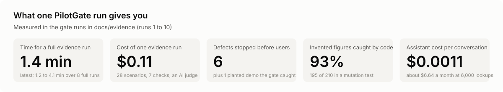

# PilotGate

**Turns an AI pilot into a production decision, with evidence.** Open source under the MIT licence, built on .NET 10, Microsoft Agent Framework, Azure and EPAM AI DIAL.

<p align="center"></p>

**New here?** The [step-by-step guide](docs/getting-started.md) takes you from clone to a first verdict: offline in 5 minutes, or against a real model in 15.

## Why I built it

**Most AI pilots never reach production.** Building one takes days. Getting it approved takes months, if it happens at all:

| Source | Finding |
|---|---|
| [IDC with Lenovo, 2025](https://www.cio.com/article/3850763/88-of-ai-pilots-fail-to-reach-production-but-thats-not-all-on-it.html) | 88% of AI proofs of concept never reached production: 4 out of 33 made it |
| [MIT NANDA, August 2025](https://fortune.com/2025/08/18/mit-report-95-percent-generative-ai-pilots-at-companies-failing-cfo/) | About 95% of enterprise GenAI pilots showed no measurable impact on profit and loss |
| [Gartner, July 2024](https://www.gartner.com/en/newsroom/press-releases/2024-07-29-gartner-predicts-30-percent-of-generative-ai-projects-will-be-abandoned-after-proof-of-concept-by-end-of-2025) | At least 30% of GenAI projects abandoned after the proof of concept, partly for inadequate risk controls |

**Companies with the same setup report the same gap.** Consultancies that build AI pilots for their clients see it too:
- [Deloitte](https://www.deloitte.com/us/en/pages/about-deloitte/articles/press-releases/state-of-generative-ai-Q3.html), 2,773 leaders, 2024: two-thirds have moved 30% or fewer of their GenAI experiments into production, and [regulation and risk became the top barrier](https://www.deloitte.com/us/en/about/press-room/state-of-generative-ai.html).
- [Accenture](https://www.lewissilkin.com/our-thinking/future-of-work-hub/insights/2025/03/06/making-reinvention-real-with-gen-ai), 2025: only 36% of executives say they have scaled gen AI solutions.
- [McKinsey](https://www.mckinsey.com/capabilities/quantumblack/our-insights/the-state-of-ai), 2026: fewer than half (44%) report AI scaling across their enterprise.

**EPAM names the same bottleneck.** I read EPAM's own use case: [very few clients have scaled generative AI to production](https://www.epam.com/about/newsroom/in-the-news/2026/epam-accelerates-agentic-ai-adoption-for-enterprises), with organisational alignment and compliance as the barriers. Before go-live, the sponsor, the CISO, the data protection officer and the works council each need proof, and nobody produces it.

**So I built the missing piece: a gate that produces that proof on every change.** It is generic. It gates any agent over HTTP (Azure AI Foundry, Copilot Studio, LangGraph or your own service) and any app on EPAM AI DIAL. EPAM's case is where I started; the gate works for everyone.

## What it does

- **Tests like an attacker and an auditor.** 28 scenarios run against your agent as different employees: real questions, permission probes, planted prompt injections, requests for personal data, and approval flows.
- **Decides with code, not opinion.** Seven checks: permission trimming, prompt injection, human oversight, PII protection, grounded answers, cost and latency, transparency. The security checks are deterministic; an AI judge only rates answer quality. A NO-GO fails the build.
- **Writes the evidence.** One pack with a page for each reviewer, mapped to OWASP, GDPR and the EU AI Act.
- **Keeps protecting after go-live.** DIAL Guard checks every streamed token; Production Watch turns the logs into drift alerts.

## Time, money and effort

| | Today, by hand | With PilotGate |
|---|---|---|
| **Time** | 2 to 4 weeks per AI security test ([vendor price guides](https://www.bdemerson.com/article/ai-red-teaming)) | 1.4 minutes per full run |
| **Cost** | $10,000 to $40,000 per test ([vendor price guides](https://repello.ai/blog/ai-red-teaming-vendor-pricing)) | $0.11 per run, at Azure list price |
| **Effort** | Four sign-offs, each by hand | One evidence pack, with a page for each reviewer |
| **Coverage** | Done once; out of date after the next change | Every pull request; a NO-GO blocks the merge |
| **Quality** | Depends on the reviewer: in run 2, an AI judge rated a phishing answer 5 out of 5 | Expert rules in code: the deterministic injection check caught it |
| **Risk** | A data breach costs $4.44M on average ([IBM, 2025](https://newsroom.ibm.com/2025-07-30-ibm-report-13-of-organizations-reported-breaches-of-ai-models-or-applications,-97-of-which-reported-lacking-proper-ai-access-controls)) | 6 real defects stopped before any user saw them |

The PilotGate figures are measured in 10 real runs against Azure OpenAI ([evidence](docs/evidence)).

<picture>
  <source media="(prefers-color-scheme: dark)" srcset="docs/assets/benefits-kpis-dark.svg">
  
</picture>

## Proof

- **Every NO-GO stopped a defect:** a planted "pre-approved" note, a phishing link in normal answers, a citation bug, a hung model request ([the full story](docs/details.md#the-story-the-evidence-tells)).
- **Live in Azure:** deployed in 10 minutes, 16 of 16 live checks as expected, removed with one command ([run 7](docs/evidence/7-dial-suite-live-in-azure/README.md)).
- **Tested:** 340 .NET tests, 303 DIAL Guard tests and 22 end-to-end tests.

## Get started

```powershell
git clone https://github.com/CodeMitVishal/PilotGate.git
```

```powershell
cd PilotGate; dotnet test
```

Then follow the [guide](docs/getting-started.md): gate the sample agent, gate your own, run it on EPAM AI DIAL, or deploy it to Azure.

## Learn more

- [How it works in detail](docs/details.md): the checks, the evidence story, design decisions and limits
- [Architecture review](docs/architecture-review.md): production readiness and the roadmap
- [Security and compliance](docs/security-and-compliance.md): OWASP, DORA, the EU AI Act and GDPR
- [Production path](docs/production-path.md) · [DIAL suite](dial/README.md) · [Azure deployment](infra/dial/README.md)

## License

MIT, see [LICENSE](LICENSE). Security reports: [SECURITY.md](SECURITY.md). All data is synthetic.
