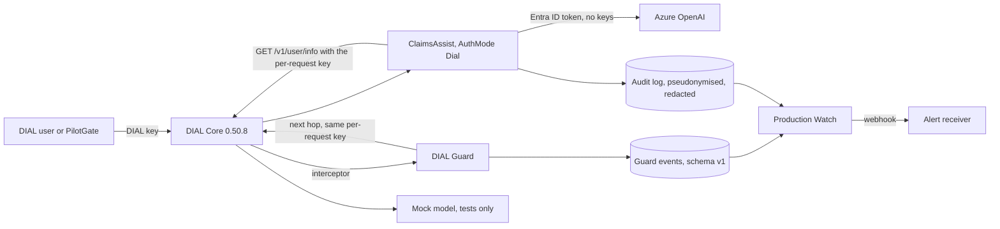

# PilotGate suite for EPAM AI DIAL

Three products for AI applications that run on EPAM's open-source AI DIAL platform (Apache 2.0), and ClaimsAssist as
a real DIAL application to run them against. Plan, decisions and acceptance matrix: [docs/suite/PLAN.md](../docs/suite/PLAN.md).

| Product | Stage | What it does |
|---|---|---|
| **DIAL Guard** (`dial/guard`, Python) | Runtime, inside DIAL | A DIAL interceptor on EPAM's `aidial-interceptors-sdk` 0.9.0 (see the list below) |
| **PilotGate DIAL mode** (`src/PilotGate`, `--dial`) | Before release | Runs the 27 gate scenarios against an application hosted on DIAL, through DIAL Core, as a black box. Checks that need the agent's trace report "not measurable" and never pass |
| **Production Watch** (`src/ProductionWatch`) | In production | Reads guard events and the application's audit log. Computes windowed metrics and drift against thresholds, optionally re-scores a cost-capped sample with an LLM judge, and alerts through a webhook |

What DIAL Guard does on every request and response of the deployments it is attached to:
- quarantines instructions planted in tool output and attachments;
- holds streamed text back until it is checked;
- removes links to hosts outside an allow-list;
- redacts PII;
- stops a choice when a canary leaks;
- writes one event per finding.

ClaimsAssist runs as a DIAL application with `ClaimsAssist__AuthMode=Dial`. Its identity comes only from DIAL Core, and its development endpoints do not exist in that mode.



## Run it locally

Prerequisites:
- Docker Desktop.
- The .NET 10 SDK.
- For ClaimsAssist: `az login` and the Azure OpenAI account from `infra/main.bicep`.
- For the end-to-end tests: Python 3.12.

Generate the stack's secrets. They are git-ignored, and an existing setup is kept:

```powershell
./dial/stack/setup.ps1
```

Start DIAL Core, Redis, DIAL Guard and the mock model. Only DIAL Core is published, on 127.0.0.1:8080:

```powershell
docker compose -f dial/stack/docker-compose.yml up -d --build --wait
```

Run ClaimsAssist as a DIAL application on 127.0.0.1:5280, in its own terminal:

```powershell
./dial/stack/run-claimsassist.ps1
```

Ask ClaimsAssist through DIAL Core and DIAL Guard as a property handler (keys are in `dial/stack/keys.json`):

```powershell
$key = (Get-Content dial/stack/keys.json -Raw | ConvertFrom-Json)."anna.property"
Invoke-RestMethod http://localhost:8080/openai/deployments/claimsassist/chat/completions -Method Post -Headers @{ "Api-Key" = $key } -ContentType "application/json" -Body '{"messages":[{"role":"user","content":"What is the deductible for storm damage?"}]}'
```

Gate the DIAL deployment with PilotGate. The run costs about $0.15:

```powershell
dotnet run --project src/PilotGate -- run --config gate/gate.json --dial http://localhost:8080 --label "DIAL target"
```

Check the guard events and the audit log with Production Watch:

```powershell
dotnet run --project src/ProductionWatch -- --config watch/watch.json
```

Production Watch exit codes:
- 0: healthy;
- 1: alert;
- 2: configuration or input error;
- 3: the alert could not be delivered.

Watch is scheduled hourly in `pipelines/watch.yml`.

## DIAL Guard configuration

The configuration lives in DIAL Core, in the interceptor's `defaults.custom_fields.interceptor_configuration`. Core replaces any value a client sends. Every default is the strictest value. Profiles are several interceptor entries that point at the same endpoint with different defaults (see `dial/stack/config/core-config.base.json`).

| Field | Default | Meaning |
|---|---|---|
| `mode` | `enforce` | `monitor`: events only, content unchanged |
| `on_guard_error` | `fail_closed` | `fail_open`: when the guard itself fails, the rest of the response passes unchecked, with an event each time |
| `allowed_link_hosts` | none | Hosts (and their subdomains) that links may point to. Relative DIAL storage links are always allowed |
| `pii` | all six | `email`, `iban`, `phone_de` (+49, 0049, 0...), `date_de`, `card` (Luhn-checked), `phone_intl` (+ or 00) |
| `canaries` | none | Strings that must never reach a user: the choice stops with `finish_reason: content_filter` |
| `tool_names` | none | Tool names whose mention in untrusted text marks a planted command |
| `quarantine_untrusted` | true | Quarantine tool messages, attachment text and history stages |
| `flag_user_messages` | true | Record user messages that look like an injection (never changed) |
| `reject_external_attachments` | true | HTTP 400 for a request attachment outside DIAL storage and the allowed hosts |
| `max_link_length` | 2048 | Longer links are removed whole, in streaming and block mode alike |
| `max_scan_seconds` | 5.0 | Scan budget per request; beyond it, `on_guard_error` applies |

Contracts that keep the guard and the .NET implementation in step:
- **Shared corpus.** `dial/schema/guard-corpus.v1.json` holds attack, link and PII cases with expected verdicts. The Python tests and the .NET `GuardCorpusTests` both run it. Regenerate it with `python tools/build_corpus.py ../schema/guard-corpus.v1.json` from `dial/guard`, and review every changed case by hand.
- **Event schema.** `dial/schema/guard-event.v1.schema.json` is strict: an event never contains the matched value. The guard's tests validate what it writes, and Watch validates what it reads.

## Tests

| Suite | Command | What it proves |
|---|---|---|
| Guard, offline (303 tests) | `./scripts/test-guard.ps1` (pinned Linux image, hash-locked dependencies; `-FuzzScale 10` for a long fuzz run) | Unit and break-it tests. Property tests on two PII profiles: streaming equals block output for any split; nothing the guard acts on survives; planted PII never survives; idempotence. Also the real SDK app over replayed DIAL Core fixtures, fail-closed and fail-open, timeouts, concurrency |
| .NET, offline (340 tests) | `dotnet test` | ClaimsAssist (including the DIAL endpoint, its trust model, startup refusals and the shared corpus), PilotGate (including DIAL mode: black-box checks warn, never pass), Production Watch |
| End to end (22 tests) | `dial/guard/.venv/Scripts/python -m pytest -m e2e tests/e2e` from `dial/guard`, with the stack and `run-claimsassist.ps1` running | 15 against DIAL Core with the guard and the mock model (no model cost); 7 with ClaimsAssist and the real model (about $0.01) |

Create the end-to-end environment once, from `dial/guard`:

```powershell
py -3.12 -m venv .venv
```

```powershell
.venv/Scripts/python -m pip install --require-hashes -r requirements.lock -r requirements-dev.lock
```

Update the locks: edit `requirements.in` or `requirements-dev.in`, then compile them with pip-tools 7.7.0 inside `python:3.12-slim` (`pip-compile --generate-hashes`), so the hashes cover the Linux image.

## What is verified, and what is not

Verified (the acceptance matrix in `docs/suite/PLAN.md` names the test or run for each item):
- **DIAL protocol:** captured from a real DIAL Core 0.50.8 (`dial/spike/README.md`, 22 facts). The guard is tested against those fixtures and through DIAL Core in Docker.
- **Leak-free streaming:** no PII value or disallowed link reaches the client in any guarded field, for any split of the stream. The property tests found and pinned several real leaks while the guard was built. One example: a German number in `0049` form that a later match hid from streaming hold-back.
- **ClaimsAssist's trust model in DIAL mode:**
  - spoofed persona and DIAL headers gain nothing;
  - unmapped roles get 403;
  - approvals are bound to their owner;
  - the development endpoints do not exist;
  - a weak pseudonymisation key stops startup;
  - failures reach the user as a 500 with a logged reference.
- **PilotGate DIAL mode:** a real run through DIAL Core and the guard (GO WITH CONDITIONS, $0.147), with the trace-dependent checks reported as not measurable.
- **Production Watch:** metrics, drift, alert delivery and retries, and the re-scoring cost cap. Tested, and also run over real logs.
- **The Azure deployment at runtime.** A one-day run on 2026-11-27 deployed it, passed the smoke test on the first attempt, and passed all 16 live flow steps. Logs reached Log Analytics, PilotGate gated it, and it was then removed. Screenshots: [docs/evidence/7-dial-suite-live-in-azure](../docs/evidence/7-dial-suite-live-in-azure/README.md).

Not verified:
- **Entra ID sign-in for DIAL users.** Only API keys were exercised.
- **Locally, ClaimsAssist listens on 127.0.0.1.** Any local process with a persona key from `keys.json` could call it directly and skip the guard. That is a local trust boundary only: in Azure it has internal-only ingress.
- **Production Watch reads files, not Log Analytics yet.**

## Limits

- **The guard's PII patterns are deterministic.** They cover the six kinds above in common European formats. Names and free-text identifiers need a model-based detector (for example Azure AI Language PII), which can run as another interceptor in the same chain.
- **Injection quarantine is a heuristic.** It is one layer of several. Azure AI Content Safety Prompt Shields is the production addition.
- **A run of overlapping PII-shaped matches longer than 512 characters fails closed.** One example is 25 e-mail addresses glued together without separators. The response then ends with a guard error rather than holding unbounded text.
- **All data is synthetic.**
