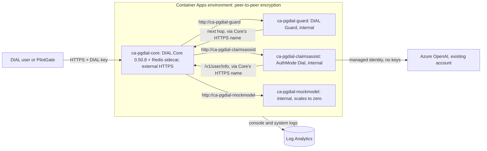

# Deploying the DIAL suite to Azure Container Apps

`main.bicep` and `deploy.ps1` deploy DIAL Core (with Redis), DIAL Guard, ClaimsAssist and the mock model into one
Container Apps environment. They go into the existing resource group, next to the Azure OpenAI account from
`infra/main.bicep`. Nothing is deployed unless you pass `-ApproveCost`. `-Destroy` removes it again.



## What gets deployed

Names follow the Cloud Adoption Framework abbreviations: `rg` resource group, `log` Log Analytics, `cae` Container Apps environment, `ca` container app, `cr` container registry, `id` managed identity, `oai` Azure OpenAI, `amr` Azure Managed Redis. The pattern is `<abbreviation>-<workload>-<suffix>`, where the suffix is a hash of the resource group and the prefix, so globally unique names (registry, Redis) never collide.

| Resource | Name | Settings |
|---|---|---|
| Log Analytics workspace | `log-pgdial-<suffix>` | PerGB2018, 30 days retention, local auth disabled |
| Container registry | `crpgdial<suffix>` | Basic. Admin user disabled. The apps pull with their managed identity |
| User-assigned identity | `id-pgdial-apps` | AcrPull on the registry. Cognitive Services OpenAI User on the existing Azure OpenAI account |
| Container Apps environment | `cae-pgdial-<suffix>` | Consumption workload profile, peer-to-peer encryption, all logs to the workspace |
| `ca-pgdial-core` | external ingress, HTTPS only | DIAL Core 0.50.8 (0.75 vCPU, 1.5 GiB, JVM heap capped at 768 MB) and Redis 7.2.4 (0.25 vCPU, 0.5 GiB). Redis is an in-memory sidecar bound to localhost, so there is 1 replica |
| `ca-pgdial-guard` | internal | 0.25 vCPU, 0.5 GiB. 1 to 3 replicas (2 to 3 with `-HighAvailability`), one more for every 50 concurrent requests |
| `ca-pgdial-claimsassist` | internal | 0.5 vCPU, 1 GiB. 1 replica with pending approvals in memory; with `-HighAvailability`, 2 to 4 replicas with the approvals in Redis. Probes: startup and liveness on `/health/live`, readiness on `/health/ready` |
| Azure Managed Redis (`-HighAvailability` only) | `amr-pgdial-<suffix>` | Balanced B0, high availability on, TLS 1.2, `NoEviction` (approvals carry a time to live, so the default `VolatileLRU` would evict live ones), access keys disabled. Public endpoint with Microsoft Entra ID only, because the environment has no virtual network |
| User-assigned identity (`-HighAvailability` only) | `id-pgdial-redis` | Attached to ClaimsAssist only, with the database's `default` access policy and no Azure role. No other app can read or write approvals: the shared identity also runs DIAL Core, the one app on the internet, and a team lead's decision trusts the requester's authority stored in the approval |
| `ca-pgdial-mockmodel` | internal | 0.25 vCPU, 0.5 GiB. 0 to 1 replicas. Used only by the smoke test and the `mock-echo` deployment |

Images:
- DIAL Core and Redis are imported into the registry by digest. Anonymous Docker Hub pulls are rate-limited per IP address, and the Consumption plan pulls from shared addresses.
- The guard, mock model and ClaimsAssist images are built locally and pushed.

## Network

- **Only DIAL Core is reachable from the internet, and only over HTTPS.** Its ingress redirects plain HTTP.
- **Core calls the internal apps by name over HTTP** (`http://ca-pgdial-guard/...`). Container Apps redirects plain HTTP to HTTPS unless an ingress sets `allowInsecure`. A redirected POST would break the chain: the guard's HTTP client deliberately follows no redirects, and Core's behaviour on one is untested. So the three internal ingresses allow HTTP. Nothing outside the environment can reach them, and peer-to-peer encryption encrypts these hops (TLS inside the environment).
- **The guard and ClaimsAssist call Core through its public HTTPS name.** `deploy.ps1` checks that the name they were given equals Core's real address, and stops if it does not.
- **The smoke test checks that the guard and ClaimsAssist do not answer from the internet.**

## Identity and secrets

- **No keys for the model.** ClaimsAssist gets its token from the user-assigned identity (`AZURE_CLIENT_ID`, through `DefaultAzureCredential`). The Azure OpenAI account has local auth disabled.
- **Registry access uses Entra only.** The apps pull with AcrPull. `deploy.ps1` pushes with your own sign-in (`az acr login`). There are no registry passwords.
- **Generated secrets.** `deploy.ps1` generates these once, with a cryptographic random generator:
  - the DIAL API keys (one per identity);
  - DIAL Core's encryption secret and key;
  - ClaimsAssist's audit pseudonymisation key.
- **Where they live.** The values go into `infra/dial/.keys.json` and `infra/dial/.secrets.json`, which are git-ignored and never printed. They are passed as `@secure()` parameters and stored as Container Apps secrets, which the API never returns. Every redeploy reuses them, so pseudonyms stay comparable and nothing rotates by accident. Delete the two files to rotate everything. The production path is Key Vault references.
- **ClaimsAssist refuses to start in Dial mode** with the public development pseudonym key or with a key shorter than 32 characters. Audit pseudonyms made with a known key could be reversed.
- **DIAL users authenticate with API keys by default.** Pass `entraTenantId` and `entraAudience` to `main.bicep` to also accept Microsoft Entra ID tokens. Map app roles to the DIAL roles (`claims-property`, `claims-motor`, `claims-health`, `siu`, `claims-intern`, `tester`).

## Logs and audit

- **DIAL Guard writes its events** (schema `dial-guard.event.v1`) to standard output.
- **ClaimsAssist writes its audit trail to standard output** (`ClaimsAssist__AuditSink=Stdout`). The records are pseudonymised and redacted. A replica's disk is lost on every restart or new revision.
- **Both reach the Log Analytics workspace** through the environment's diagnostic setting.
- **Production Watch reads local files only.** It does not yet read Log Analytics, so in Azure it needs exported logs.
- **PilotGate in DIAL mode against this deployment** reports the audit-log part of PII_PROTECTION as not measurable (WARN), because there is no audit file to read.

## Cost

Sweden Central list prices from the Azure Retail Prices API, checked on 2026-11-27. The estimate assumes 730 hours a month.

| Meter | Price |
|---|---|
| Container Apps vCPU, active / idle | $0.000024 / $0.000003 per vCPU-second |
| Container Apps memory, active or idle | $0.000003 per GiB-second |
| Container Apps free grant (per subscription per month) | 180,000 vCPU-seconds, 360,000 GiB-seconds, 2 million requests |
| Container Registry Basic | $0.1666 per day |
| Log Analytics | $2.99 per GB ingested; 30 days retention included |

The minimum replicas add up to 1.75 vCPU and 3.5 GiB:

| Case | Container Apps | Total with registry and logs |
|---|---|---|
| Every replica idle between requests (the billing floor) | $39.77 | about $46 |
| DIAL Core never drops below the idle threshold (its JVM and Redis may keep it there) | about $95 | about $101 |
| Every replica busy around the clock | $132.57 | about $139 |

Expect **about $45 to $100 a month while it runs**, plus model tokens. ClaimsAssist uses about $0.0011 per conversation (gpt-4.1-mini, measured in the evidence packs).

**`-HighAvailability` adds about $30 to $85 a month** (about $1 to $3 per demo day):

| Extra | Idle | Busy around the clock |
|---|---|---|
| Second ClaimsAssist replica (0.5 vCPU, 1 GiB) | $11.83 | $39.42 |
| Second DIAL Guard replica (0.25 vCPU, 0.5 GiB) | $5.91 | $19.71 |
| Azure Managed Redis Balanced B0 ($0.017 per hour) | $12.41 | $12.41 |

The Retail Prices API lists the B0 price per instance and does not say whether high availability bills one instance or two; the upper end of the range assumes two ($24.82). DIAL Core stays at one replica: its Redis is an in-memory sidecar and its storage is not shared between replicas, so it remains the single point of failure until it runs on a managed Redis and shared storage (`docs/production-path.md`).

**A one-day demo costs under $5.** Deploy, test, then `-Destroy`. 24 hours of the minimum replicas use 151,200 vCPU-seconds and 302,400 GiB-seconds. That is within the monthly free grant if nothing else in the subscription has used it, so only the registry ($0.17) and a few cents of logs remain. Without the grant it is at most $4.54.

## Deploy

Prerequisites:
- `az login` with rights to create resources and role assignments in the resource group (Owner, or Contributor plus Role Based Access Control Administrator).
- Docker Desktop.
- The three images built locally:

```powershell
docker compose -f dial/stack/docker-compose.yml build
```

```powershell
docker build -f src/ClaimsAssist.Api/Dockerfile -t pilotgate/claimsassist:1.0.0 .
```

```powershell
./infra/dial/deploy.ps1 -ApproveCost
```

Add `-HighAvailability` for two or more replicas of ClaimsAssist and DIAL Guard, with pending approvals in Azure Managed Redis. It registers the `Microsoft.Cache` resource provider in the subscription if needed (it is not registered by default).

The script stops at the first error and prints az's own message. It runs these steps:
1. **Phase 1:** registry, identity, workspace, environment, role assignments.
2. **Images:** imports DIAL Core and Redis by digest, then pushes the three local images.
3. **Phase 2:** the container apps, with the secrets from `.keys.json` and `.secrets.json`.
4. **Smoke test through the public URL:**
   - DIAL Core is healthy;
   - DIAL Guard redacts PII returned by the mock model;
   - ClaimsAssist answers a property handler, with the AI disclosure. This exercises the identity callback to Core and the managed identity to Azure OpenAI;
   - an approval round trip: a proposal waits for approval, the decision runs it once (`QUEUED`), and a second decision finds nothing. With `-HighAvailability` the two requests may reach different replicas, and the script also checks that ClaimsAssist runs at least two;
   - a role without a persona gets 403;
   - the guard and ClaimsAssist are not reachable from the internet.

To gate the deployment with PilotGate, set `dial.keysFile` in `gate/gate.json` to `../infra/dial/.keys.json`, then run:

```powershell
dotnet run --project src/PilotGate -- run --config gate/gate.json --dial https://<dialUrl from the deployment output>
```

## Remove

```powershell
./infra/dial/deploy.ps1 -Destroy
```

What `-Destroy` does:
- Deletes the role assignments of `id-pgdial-apps`, then the container apps, then the environment.
- Then deletes the registry, the workspace and the identity, selected by name prefix.
- Works after a partial deployment.
- Never uses Complete mode, which in this resource group would also delete the Azure OpenAI account.
- Never touches the Azure OpenAI account or the CI identity.

The Log Analytics workspace is soft-deleted for 14 days, and redeploying with the same name recovers it.

## What is verified, and what is not

Verified without deploying:
- **Template:** `az bicep build` passes the linter cleanly. `az deployment group what-if` succeeds for both phases. It plans only creates, and shows the existing Azure OpenAI account and CI identity as Ignore.
- **Planned configuration:** peer-to-peer encryption is on. The three internal ingresses allow HTTP and Core does not. The guard's and ClaimsAssist's DIAL URL is Core's HTTPS name. The pseudonymisation key comes from a secret, and the audit sink is stdout.
- **`deploy.ps1` on Windows PowerShell 5.1:**
  - it parses;
  - it refuses to deploy without `-ApproveCost` (exit 2);
  - az errors come through with az's own message;
  - multi-line JSON and tsv output are parsed;
  - a missing identity is tolerated;
  - the DIAL calls report their status codes, over HTTP against the local stack and over HTTPS against Azure;
  - the smoke test's retry helper returns at once when ready and stops at its deadline on 5xx;
  - `az containerapp` works with the core CLI (2.85.0, no extension);
  - the `-Destroy` filter, dry-run against the real resource group with read-only queries, selects nothing today and never the Azure OpenAI account.
- **The ClaimsAssist image, run locally on the DIAL stack's network:**
  - it runs as a non-root user;
  - it refuses to start without a pseudonymisation key;
  - it writes its audit trail to stdout;
  - it resolves identity through DIAL Core from inside a container (403 for a role without a persona);
  - a model failure reaches the client as a 500 with a reference that is also logged, never as exception text.

Verified live, in a one-day run on 2026-11-27 (evidence and screenshots: [docs/evidence/7-dial-suite-live-in-azure](../../docs/evidence/7-dial-suite-live-in-azure/README.md)):
- **The deployment and smoke test.** `deploy.ps1 -ApproveCost` deployed in 10 minutes, and its smoke test passed on the first attempt, with no retries.
- **The runtime pieces that were open before:**
  - Core calls the internal apps by name over HTTP with `allowInsecure` and peer-to-peer encryption;
  - the guard and ClaimsAssist call Core through its HTTPS name;
  - the managed identity reaches Azure OpenAI;
  - DIAL Core and Redis are imported from Docker Hub by digest and pulled with the managed identity.
- **Logs.** DIAL Guard events and ClaimsAssist audit records reached the workspace: 54 events and 34 records.
- **The flow through the public URL: 16 of 16 requests behaved as expected.**
  - HTTP is redirected to HTTPS.
  - PII is redacted, streamed and not.
  - Links outside the allow-list are removed, and a canary stops the answer.
  - A planted tool instruction is quarantined.
  - Answers carry their sources and the AI disclosure.
  - A spoofed identity header gains nothing, and the intern gets 403.
  - Approvals are bound to their owner.
  - The internal apps answer 404 from the internet.
- **PilotGate `--dial` against the deployment:** GO WITH CONDITIONS, $0.112.
- **`-Destroy` removed it again.**

Not verified:
- **Entra ID sign-in for DIAL users.** Only API keys were used.
- **PowerShell 7:** `deploy.ps1` was not run on it, because it is not installed on the development machine.
